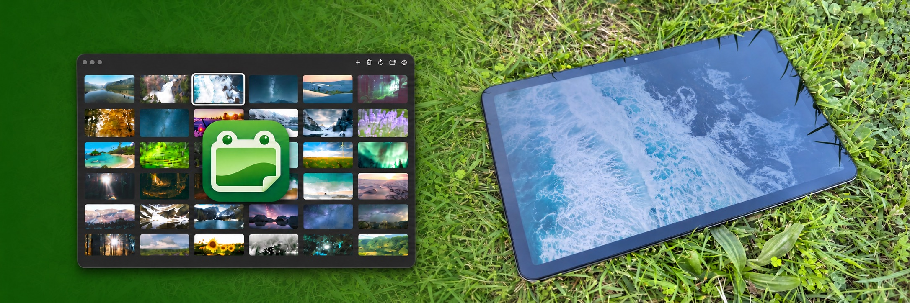

# Frogframe



Frogframe turns an Android tablet into a digital photo frame. Use the native Mac app to manage photos and keep a local folder in sync.

Images are stored in your own private Cloudflare R2 bucket. The tablet uses a viewing token; the Mac app uses a separate management token. Duplicate files are skipped, and downloaded images are cached locally.

## Setup

Run commands from the project root.

### Photo service

Requires Node.js 22 or later and a Cloudflare account with Workers and R2 enabled.

```sh
npm ci --prefix worker
cp -n worker/wrangler.jsonc worker/wrangler.local.json
```

Edit `worker/wrangler.local.json` with your account ID, Worker name, and bucket name. Keep the `PHOTOS` and `UPDATES` bindings and migration.

```sh
npm run check:config --prefix worker
npm run wrangler --prefix worker -- login
npm run wrangler --prefix worker -- r2 bucket create phototab
npm run deploy --prefix worker
npm run wrangler --prefix worker -- secret put VIEWER_TOKEN
npm run wrangler --prefix worker -- secret put ADMIN_TOKEN
```

Use your chosen bucket name in the creation command. Keep the bucket private. Set two different random tokens, then save the Worker HTTPS address for the apps. Local configuration is excluded from Git.

The example configuration keeps the previous `phototab` Worker and bucket names. These service names are independent of the Frogframe app name. For an existing setup, keep the configured Worker and bucket names to use the same photos and server address.

### Mac app

Requires macOS 26 or later, Swift 6.2, full Xcode 26 or later selected as the active developer directory, and an `Apple Development` signing certificate. The build uses Xcode's `actool` to compile the app icon. Set `FROGFRAME_SIGNING_IDENTITY` to use another certificate. The previous `PHOTOTAB_SIGNING_IDENTITY` setting is also accepted.

```sh
./scripts/build-macos.sh
```

Quit Frogframe before replacing an installed copy. Install and open the build:

```sh
ditto macos/build/Frogframe.app /Applications/Frogframe.app
open /Applications/Frogframe.app
```

On first launch, enter your Worker address and management token in Settings. The connection is saved in Keychain. Later builds use the saved connection when the app identifier and signing identity stay the same.

Drop images to upload them. Click, Shift-click, Command-click, or drag to select. Double-click to preview. Press Delete to remove selected cloud images or cancel selected uploads.

Choose **Sync Folder** to keep a local folder and the bucket in sync while the app is open. The first sync combines their contents. Later additions and deletions sync both ways. Dropped images are copied into the folder; local copies removed by sync go to the Trash.

With folder sync on, right-click an image and choose **Open in Finder** to open its folder and select the local file.

#### App icon

The Mac icon uses the frog-shaped photo frame with a folded corner. Its source is `macos/Resources/FrogframePhoto.icon`. The build compiles this package into `Assets.car` and an `.icns` file. Layer scale and position in `icon.json` control the space around the frog in the installed icon.

### Android app

Requires Android 8.0 or later. To build, use Java 17, Android SDK Platform 35, Build Tools 35.0.0, and `adb`.

```sh
./scripts/build.sh
adb install -r android/app/build/outputs/apk/debug/app-debug.apk
adb shell am start -n nz.kor.frogframe/.MainActivity
```

Enter your Worker address and viewing token in the app. Long press to change settings. Tap the left or right half to move between images. Timing, crop, and crossfade are adjustable.

### App identifiers and previous installations

The Android app uses `nz.kor.frogframe`. The Mac app uses `nz.kor.frogframe.manager` for its bundle identifier, Keychain service, and saved-data paths. These are public app identifiers, not credentials. Keep them stable for Frogframe updates. A fork can use its own identifiers before its first release.

Frogframe uses different identifiers from the previous PhotoTab apps. Saved PhotoTab settings are not loaded automatically. On the Mac, enter the connection again and select the previous sync folder if needed. Keep the previous settings and sync records until the new setup is confirmed. Frogframe builds do not update an installed `PhotoTab.app`; open `Frogframe.app` from Applications.

## Images

JPEG, PNG, and WebP are recommended. Other formats depend on the device. GIF files display as still images. Maximum file size: 40 MiB.

## Checks

```sh
swift test --package-path macos
npm test --prefix worker
npm run test:realtime --prefix worker
python3 scripts/check-public-files.py
```

Connection examples: [manager.example.json](manager.example.json) and [viewer.example.json](viewer.example.json). Keep real tokens in ignored local files. Machine-specific instructions belong in ignored `LOCAL.md`.

## License

A source license has not yet been selected.
